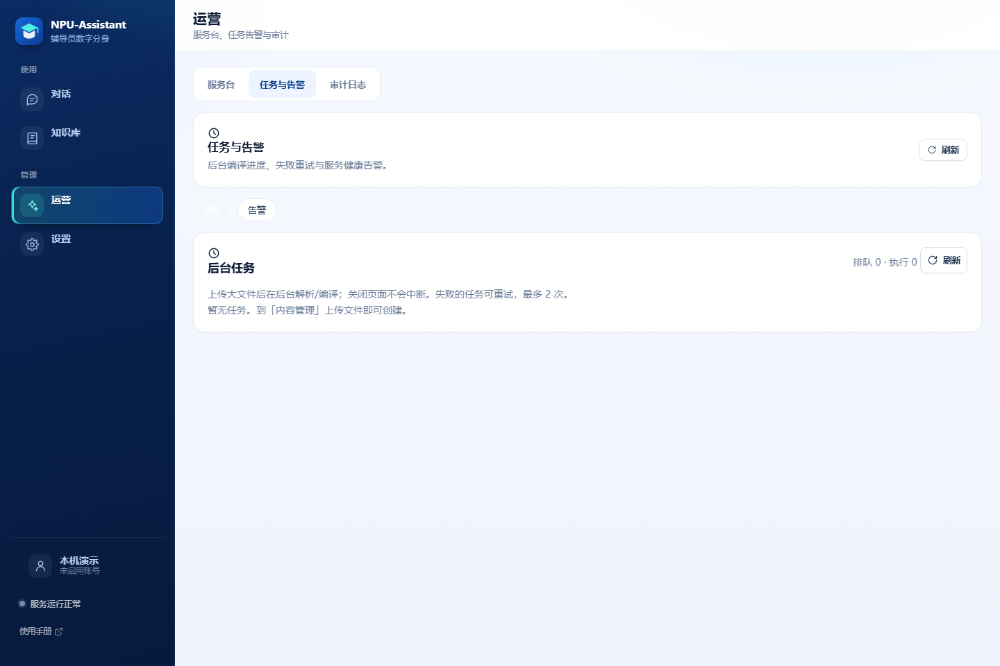

# NPU-Assistant · 校园辅导员数字分身（LLM Wiki）

> [!IMPORTANT]
> **AI 生成声明**：本项目完全由 AI 生成，包括代码、测试、文档与界面。贡献模型包括 **Deepseek-v4.1-flash** 和 **GLM-5.3-flash**。项目按“现状”提供，未经过完整的人工安全审计；用于生产环境前请自行评估与加固。

把学生手册、奖助政策、办事指南交给 LLM **编译成结构化 Wiki 词条**；学生提问时通过「目录 / 别名 / 关键词 / LLM 选页」定位词条，再由 LLM 阅读词条作答，并给出**词条 + 原始文件章节**双层引用——答案可核对、词条可编辑、系统可离线演示。后端 FastAPI + SQLite，前端纯静态，无 Node 构建、无向量库。

> 当前版本：**v0.2.0**（2026-11-09 发布）· 变更见 [CHANGELOG.md](CHANGELOG.md) · QA 数据集见 [docs/npu-handbook](docs/npu-handbook/README.md)
>
> 📘 **学生 / 辅导员请直接看 [图文使用手册](frontend/manual/index.html)**（手机截图、动图、常见问题）；服务启动后也可访问 <http://127.0.0.1:8000/manual/index.html>

---

## 🌟 两个关键差异

**① 单个 LLM 驱动，不用堆模型组件**

经典 RAG 知识库往往要同时配 embedding 模型、向量库、rerank 模型，还要调 chunk 大小与召回参数；本项目**只需要一个 LLM**（OpenAI 兼容接口或本地 Ollama）——编译、导航选页、作答、完整性判断共用同一个模型，质量来自「编译好的结构化词条 + 标题 / 别名 / 关键词 / 标签导航」，而不是向量召回。配置成本从「一栈模型」降到「一个 Key」；不配模型时还能用预编译快照 + 摘录式降级离线演示。

**② RSI 自进化，知识库越用越全、越用越新**

传统知识库依赖人工逐篇整理文档，整理完就逐渐过期，坏答案也没人知道。本项目把这条链做成了闭环：学生「没帮助 + 原因」→ 自动聚合成**知识缺口**并按频次排序 → 辅导员补资料 / 关联词条 → LLM 重新编译成带来源锚点的词条 → 同类问题下次直接命中。使用越多，缺口越少、词条越全；同时用发布 / 生效 / 失效日期派生时效状态（fresh / aging / stale / expired），过期内容自动降权或退出问答，避免「答案停在两年前」。

| 维度 | 经典 RAG 知识库 | 传统人工知识库 | 本项目 |
|------|----------------|----------------|--------|
| 模型配置 | embedding + 向量库 + rerank + LLM | 通常无模型 | **单个 LLM**（OpenAI 兼容 / Ollama） |
| 知识形态 | 切片 chunk，召回结果不可读 | 人工撰写的文档 / FAQ | LLM 编译的 **Wiki 词条**，可读可编辑、带来源锚点 |
| 知识更新 | 重建索引，人工调参 | 人工逐篇整理 | 反馈 → 缺口 → 补料 → **自动重编译** |
| 过期治理 | 靠人工发现 | 靠人工记忆 | 时效字段派生 + 过期降权 / 退出问答 |

## ✨ 使用亮点

- 🔍 **答案可核对**：回答句末的 `[n]` 引用，点开是「Wiki 词条 + 来源文件·章节·原文摘录」双层出处——不是"模型说"，而是"文件这么说"。
- 🛡️ **不编造、有兜底**：知识库没有就明说，并引导官网 / 转人工；心理危机、人身安全等话题在调用模型**之前**拦截，优先给紧急联系渠道和工单。
- 📱 **手机就能运营**：辅导员扫码打开，转发链接、粘贴文本、上传文件即可收录，LLM 自动编译成可编辑的 Wiki 词条。
- 🤖 **微信 / QQ 机器人**：机器人与网页共用同一套问答链路；管理员在聊天里转发链接即可自动入库。
- 🔁 **反馈闭环**：学生点「没帮助 + 原因」自动聚合成知识缺口，服务台按频次排序，"补资料 → 更新词条"形成闭环。
- 💻 **单机可跑、可离线**：无需 Node.js 和数据库服务；冷启动自动导入**75 篇真实来源**的预编译 Wiki 快照，不配 API Key 也能完整演示。

## 🧑‍🎓 学生：怎么用

1. **打开助手**：用辅导员给的网址，或扫二维码（手机、电脑同一服务，无需装 App）；手机浏览器可"添加到主屏幕"当 App 用。
2. **像问辅导员一样提问**：例如「国家奖学金怎么申请？需要哪些材料？」。一次问一件事，带上年级 / 类别回答更准。
3. **核对引用**：句末 `[1][2]` 对应下方引用卡片，点「来源 N」可展开原始文件章节与原文摘录，重要事项以原文为准。
4. **没答好就反馈**：点「有帮助 / 没帮助 + 原因」帮助改进知识库；或点「联系辅导员」转人工生成工单。
   ⚠️ 紧急情况（心理危机、人身安全）请直接拨打 **110 / 120** 或联系学校心理中心，不要依赖 AI。

> 更多提问技巧与截图见 [图文使用手册 · 学生篇](frontend/manual/index.html)。

## 🧑‍🏫 辅导员：日常怎么用

**A. 看学生问得怎么样（服务台）**
登录后进入「服务台」：学生反馈聚合出的**知识缺口**按频次排序 → 补资料 / 关联词条 / 关闭；「联系辅导员」生成的**转人工工单**可查询、有 SLA；危机工单置顶提醒。

**B. 维护知识库（手机 / 电脑均可）**
1. 「知识库 → 内容管理 → 收录资料」三种方式任选：粘贴**链接**（一次最多 5 个）、粘贴**转发文字**、**上传文件**（md / pdf / docx / doc / xlsx 等）；
2. LLM 后台编译（大文件返回任务进度，可重试 / 取消），完成后自动生成带来源锚点的词条；
3. 检查词条：浏览目录、按标签筛选、手工编辑摘要与正文，必要时对源文件「重新编译」；
4. 过期内容在词条上维护生效 / 失效日期，过期后自动不参与问答。

**C. 机器人（可选）**
QQ 官方机器人填 AppID / AppSecret 即自动连接（无需公网）；微信公众号为明文模式回调。管理员在聊天里发链接 → 自动抓取入库；发送 `#状态`、`#帮助` 管理与查询。

> 操作细节、常见失败原因与排障见 [图文使用手册](frontend/manual/index.html) 与 [管理员与运维手册](docs/ADMIN-OPS.md)。

## 🚀 5 分钟跑起来

**环境要求**：Windows 10 / 11 + Python 3.11+（macOS / Linux 手动执行等价命令即可）；无需 Node.js、无需数据库服务。

```powershell
cd NPU-Assistant

# 一键：建虚拟环境 → 装依赖 → 启动（默认 http://127.0.0.1:8000）
.\scripts\bootstrap.ps1

# 或分步执行
python -m venv .venv
.\.venv\Scripts\python.exe -m pip install -r backend\requirements.txt
.\scripts\run.ps1
```

启动后打开 <http://127.0.0.1:8000>：

1. 首次启动自动建库并**导入预编译 Wiki 快照**，可直接浏览词条目录、搜索、看来源锚点；
2. 未配置真实 LLM 时，问答降级为「词条摘录」（仍带引用），可完整体验导航与引用链路；
3. 到「设置 → 模型」配置 DeepSeek（推荐）或 Ollama 本地模型并设为默认，即获得完整 LLM 回答与上传编译能力，详见 [ADMIN-OPS · 模型配置](docs/ADMIN-OPS.md)；
4. **手机访问**：`.\scripts\run.ps1 -Lan`，然后点右上角「手机扫码」；端口占用改用 `-Port 8010`。

完整部署（公网 / 令牌 / 备份 / 升级）见 [ADMIN-OPS · 首次部署](docs/ADMIN-OPS.md)；5 分钟演示分步脚本见 [docs/DEMO.md](docs/DEMO.md)。

## 🖼️ 界面预览

> 截图由 `.\scripts\ui_check.py` 自动生成，保存在 `docs/screenshots/`。

**辅导员对话**：Wiki 词条回答 + 句末 `[n]` + 可展开的「来源 N」行。


**知识库**：学生浏览视图（搜索、分类筛选、词条卡片）；有权限的账号可进入「内容管理」维护源文件与词条。


**运营**：服务台（概览 / 缺口 / 反馈 / 工单 / 危机 / 时效）、任务与告警。



**设置**：助手设置、模型、机器人、成员与权限、我的账号。


## 📚 文档导航

| 你是谁 | 看什么 |
|--------|--------|
| **学生 / 辅导员（使用）** | 📘 [图文使用手册](frontend/manual/index.html) · [产品能力总览](frontend/manual/product.html) |
| **学院管理员 / 部署老师** | [管理员与运维手册](docs/ADMIN-OPS.md)（部署、令牌、模型、收录运营、备份、排障）· [机器人接入](docs/BOT-INTEGRATION.md) · [移动端运维](docs/MOBILE-OPS.md) |
| **开发 / 交接** | [开发手册](docs/DEVELOPER.md)（目录结构、数据模型、测试）· [架构设计](docs/ARCHITECTURE.md) · [Wiki 设计](docs/WIKI-DESIGN.md) · [API 速览](docs/API.md) |
| **评审 / 演示** | [5 分钟演示脚本](docs/DEMO.md) · [路线图](docs/ROADMAP.md) · [QA 数据集](docs/npu-handbook/README.md) · [完整文档导航](docs/README.md) |

技术原理一句话：**源文件 → LLM 编译词条 → 导航选页 → 词条阅读作答 → 双层引用**；与经典 RAG 的区别是**只需一个 LLM**、不用 embedding / 向量库 / rerank，知识被编译成人类可读、可编辑的词条，引用可逐字回溯到源文件章节；再叠加**反馈驱动的 RSI 闭环**（缺口 → 补料 → 重编译 → 时效治理），知识库随使用自我富集，而不是逐渐过期。设计细节见 [docs/WIKI-DESIGN.md](docs/WIKI-DESIGN.md)。

## ❓ 常见问题（精选）

**启动报「未找到虚拟环境」？**
先执行 `python -m venv .venv`，再 `.\.venv\Scripts\python.exe -m pip install -r backend\requirements.txt`。

**8000 端口被占用？**
`.\scripts\run.ps1 -Port 8010`；不要同时启动多个常驻服务。

**页面打不开 / 提示「前端资源尚未就绪」？**
前端由后端托管，不要直接双击 `frontend/index.html`，请通过 <http://127.0.0.1:8000> 访问。

**上传文件后编译失败，或回答总是降级？**
Wiki 编译与高质量回答需要真实 LLM：到「设置 → 模型」配置 DeepSeek / Ollama 并设为默认，详见 [ADMIN-OPS · 模型配置](docs/ADMIN-OPS.md)。

**想恢复初始状态？**
停止服务后删除 `backend/data/app.db`，重新启动即自动重建并导入快照。

> 更多问题见 [图文使用手册 · FAQ](frontend/manual/index.html) 与 [ADMIN-OPS · 排障手册](docs/ADMIN-OPS.md)。

## ⚠️ 使用边界与免责声明

- 本项目为**教学演示 / MVP**，与西北工业大学无隶属或背书关系，不是学校官方信息系统；示例政策内容不可作为实际办事依据，请以学校官方通知为准。
- AI 编译与回答可能存在遗漏或偏差；奖学金、学籍、毕业、贷款等关键事项，请核对引用原文并与辅导员或职能部门核实。
- 当前已知边界：编译依赖真实 LLM、导航可能选错页、无语义检索（设计取舍）、单进程 SQLite、快照会随源文件过期；完整清单见 [产品能力总览 · 当前边界](frontend/manual/product.html)。
- 公网部署前务必：设置 `NPU_ADMIN_TOKEN`（≥24 位）、启用 HTTPS 反代、限制上传大小与来源 IP，并完成数据合规评估；安全清单见 [ADMIN-OPS · 安全与合规](docs/ADMIN-OPS.md)。

## 开源与许可

- **许可证**：[MIT](LICENSE)，可自由使用、修改与分发，请保留版权声明。
- **参与贡献**：[CONTRIBUTING.md](CONTRIBUTING.md)；安全问题请按 [SECURITY.md](SECURITY.md) 私下报告。
- **数据说明**：仓库内校园手册、QA 数据集与预编译 Wiki 快照来自学校官网、公众号等公开渠道，版权归原权利人，仅用于教学演示与技术验证；如权利人要求，请联系删除。
