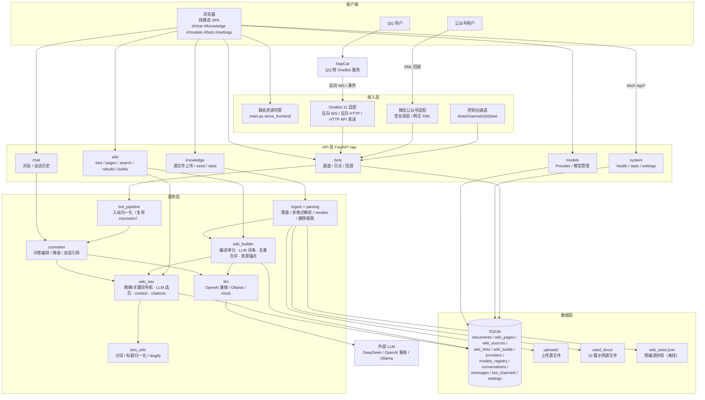
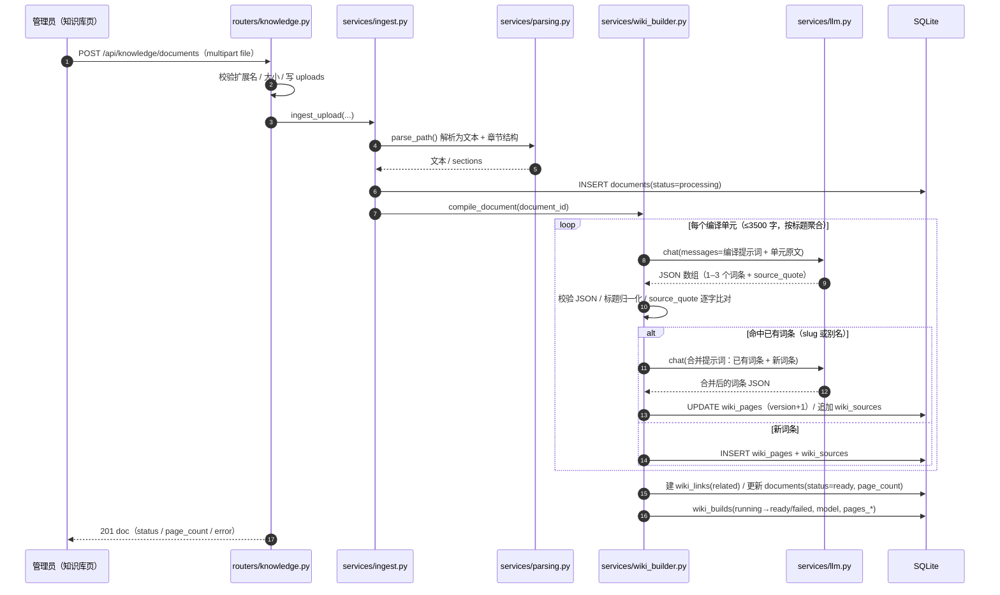
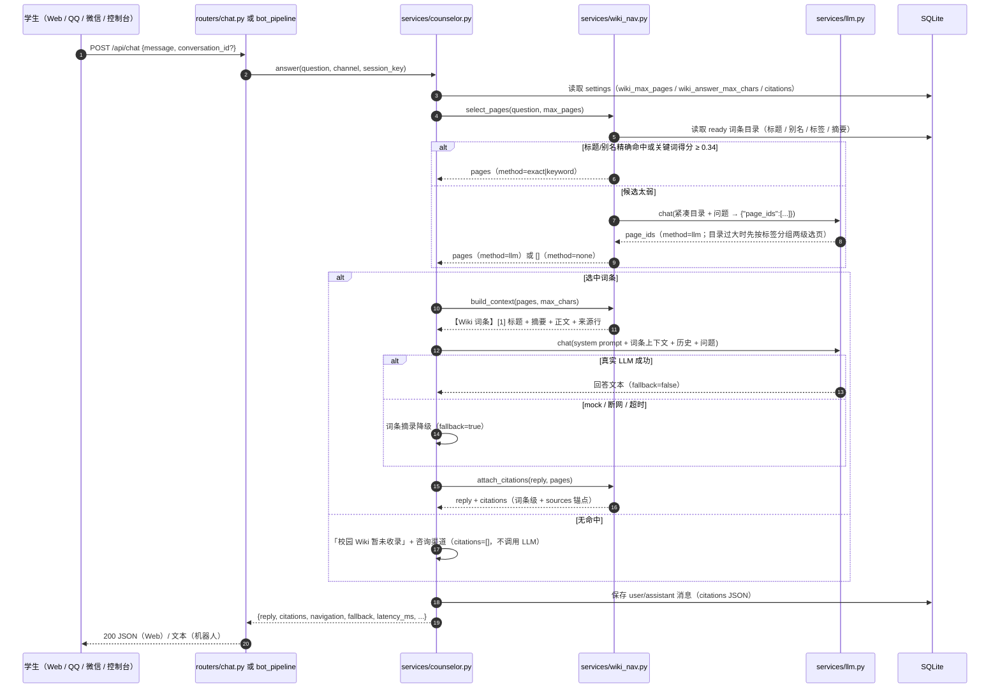
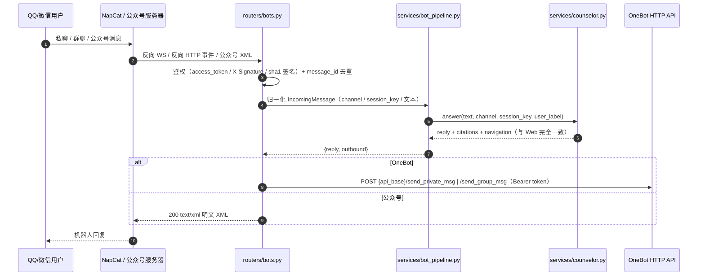
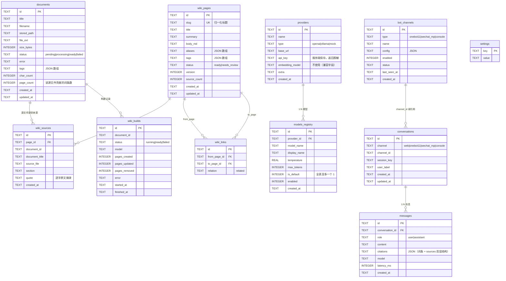

# NPU-Assistant 架构设计（LLM Wiki · v0.1.1）

本文说明 NPU-Assistant 在 **LLM Wiki 架构**下的整体结构、两条核心链路（编译 / 问答）、模块职责、数据模型与部署建议。设计与接口字段以 [WIKI-DESIGN.md](WIKI-DESIGN.md) 与 [CONTRACT.md](CONTRACT.md) 为准，本文侧重「系统如何组织起来」。

## 1. 设计目标

- **编译一次、阅读多次**：上传源文件时由 LLM 编译成结构化 Wiki 词条；查询时不再切片检索，而是导航到词条后让 LLM 阅读作答。
- **可读、可编辑、可核对**：词条是人类可读的 Markdown，可在后台直接修改；每个词条带「源文件 + 章节 + 逐字原文摘录」的来源锚点，引用可回溯。
- **单进程、零外部依赖**：FastAPI + SQLite + 纯静态前端；不引入 embedding 模型、向量数据库或 rerank 服务。
- **离线可演示**：仓库自带真实 LLM 预编译的 `wiki_seed.json`，无 API Key 冷启动即可浏览 Wiki 与降级问答。
- **多渠道复用同一问答内核**：Web、QQ、微信、控制台统一调用 `counselor.answer()`。
- **失败可退化**：LLM 不可用时上传明确失败可重试；问答降级为词条摘录（`fallback=true`），不 500。

## 2. 总体架构



## 3. 核心链路

### 3.1 上传编译链路（源文件 → Wiki 词条）



规则要点（详见 WIKI-DESIGN §3.1）：

- 解析失败、LLM 不可用、单篇编译失败 → `documents.status=failed` + 中文 `error`，可重试；
- LLM 输出非法时重试 1 次，仍失败则生成 `needs_review` 兜底词条（正文为该单元原文），不阻塞整篇文档；
- `source_quote` 必须能在单元原文中逐字找到（去空白比对），否则用单元首 120 字替换；
- 去重键为归一化标题（`slug`）+ 别名，合并由 LLM 完成；来源冲突时在正文标注；
- 删除源文件：只删除「来源全属该文档」的词条，共享词条只移除来源；清理孤儿链接。

### 3.2 问答导航链路（问题 → 词条 → 回答 + 双层引用）



约束：只读取 `status='ready'` 的词条；`needs_review` 仅在管理页展示；单页读取上限 2500 字，整包上下文上限由 `wiki_answer_max_chars`（默认 9000）控制；`[n]` 编号必须与 citations 的 `index` 一致，模型未标编号时追加「参考词条」清单。

### 3.3 机器人链路（复用 counselor）



机器人与 Web 共用同一会话表（`conversations.channel` 区分渠道），citation 结构变化对机器人透明（机器人只取 `reply`）。

## 4. 模块职责

| 层 | 模块 | 职责 |
|----|------|------|
| 入口 | `backend/app/main.py` | 装配 FastAPI、挂载 `/api` 路由、静态前端托管、统一异常处理 |
| 配置 | `backend/app/config.py` | 路径、端口、上传限制、Wiki 编译/导航参数（单元大小、上下文字数、目录上限）、默认设置与提示词 |
| 持久化 | `backend/app/db.py` | SQLite 建表与旧库迁移（DROP chunks / documents 增 `page_count`）、首启默认数据、Wiki 查询辅助 |
| 安全 | `backend/app/security.py` | 可选 `NPU_ADMIN_TOKEN`：设置后写操作校验 `X-Admin-Token` |
| API | `routers/system.py` | `/health`（`knowledge_mode`、`wiki_pages`）、`/system/info`、`/system/stats`、`/settings` 读写 |
| API | `routers/chat.py` | `/chat` 问答（双层引用 + navigation）、会话列表 / 历史 / 删除 |
| API | `routers/knowledge.py` | 源文件上传（**同步编译**）、列表 / 详情 / 删除 / reindex、seed、stats |
| API | `routers/wiki.py` | 目录树、词条列表/详情/编辑/删除、导航搜索、stats、rebuild、builds、seed |
| API | `routers/models.py` | Provider / 模型 CRUD、默认模型、连通性测试、Key 脱敏 |
| API | `routers/bots.py` | 通道 CRUD、控制台模拟、日志、OneBot WS/HTTP、公众号回调 |
| 服务 | `services/counselor.py` | 问答编排：设置 → 导航选页 → 词条上下文 → LLM/降级 → 引用组装 → 落库 |
| 服务 | `services/wiki_nav.py` | `search_pages()`（exact/keyword/llm 可观测）、`select_pages()`、`build_context()`、`attach_citations()` |
| 服务 | `services/wiki_builder.py` | 编译单元聚合、LLM 编译/合并、JSON 校验、来源锚点、去重、rebuild、seed 导入/导出、`can_compile()` |
| 服务 | `services/text_utils.py` | `tokenize()`（jieba + 停用词 + 中文 bigram）、`normalize_title()`、`slugify()` |
| 服务 | `services/ingest.py` / `parsing.py` | 上传落盘、多格式解析、reindex、删除级联（含独占词条清理） |
| 服务 | `services/llm.py` | 三类 Provider 适配与超时、默认模型、Provider/模型测试 |
| 服务 | `services/bot_pipeline.py` | 机器人统一入站：会话键规则、调用 `counselor.answer()`、outbound 报文 |
| 适配 | `adapters/onebot.py` / `wechat_mp.py` / `base.py` | OneBot 事件归一化与 HTTP API 发送、公众号签名/XML、会话键构造 |
| 前端 | `frontend/index.html` + `assets/` | 单页应用、hash 路由、5 个视图；知识库页「词条 / 源文件」双 Tab |

## 5. 数据模型



补充说明：

- **documents**：源文件是唯一事实来源；`page_count` 表示该文件编译出的词条数（不再有 `chunk_count`）。
- **wiki_pages**：LLM 编译生成的结构化词条；`slug` 唯一，`aliases` 参与导航精确匹配；`status=needs_review` 只展示、不参与问答。
- **wiki_sources**：双层引用的第二层；`quote` 为逐字原文摘录，`section` 为原文章节标题。
- **wiki_links**：词条之间的 `related` 链接，用于详情页「相关词条」。
- **wiki_builds**：编译审计日志（状态、模型、新增/更新/删除页数、错误、起止时间）。
- **settings**：`counselor_name`、`system_prompt`、`welcome_message`、`quick_questions`、`wiki_max_pages`（默认 3）、`wiki_answer_max_chars`（默认 9000）、`citations_enabled`、`bot_reply_footer`。旧 `retrieval_top_k/retrieval_min_score` 已删除。

## 6. 为什么移除经典 RAG

早期原型采用「切片 + jieba + BM25」检索；v0.1.0 起改为 LLM Wiki，原因与取舍：

| 维度 | 经典 RAG（已移除） | LLM Wiki（当前） |
|------|---------------------|------------------|
| 知识单元 | 300–600 字切片，边界机械、上下文易割裂 | LLM 编译的完整词条（概述/流程/材料/时间/注意），人类可读 |
| 检索 | BM25 / embedding 相似度 | 标题/别名精确匹配 + 关键词覆盖率 + LLM 读目录选页 |
| 引用 | 切片 ID + 文档标题，难以逐字核对 | 词条级 + 来源锚点（文件/章节/逐字摘录），可人工核对 |
| 可维护性 | 切片不可编辑，更新需重建全库 | 词条可直接编辑/合并/标注 `needs_review`，按文档重建 |
| 基础设施 | 需向量库/embedding 模型（或 BM25 词表） | 仅 SQLite + 一次 LLM 调用/编译单元；无 embedding、无 rerank |
| 成本 | 查询时按切片召回，无编译成本 | 编译有 Token 成本；种子快照避免重复编译 |
| 风险 | 切片相关性依赖词法/向量质量 | 编译幻觉（用逐字 quote 校验 + needs_review 兜底）、导航错页（可观测 `method` 并人工修正） |

**明确边界**：不实现 embedding、向量数据库、rerank、chunk 检索；不实现流式输出；单机规模假设为几十~几百篇源文件、<1000 个词条。

## 7. 部署建议

### 7.1 单机演示（推荐用于评审）

```powershell
.\scripts\run.ps1                      # 或 .\scripts\run.ps1 -Port 8010
# 反向代理（可选）：Nginx / Caddy 将 80/443 转发到 127.0.0.1:8000
```

- 保持单进程（uvicorn 单 worker）：SQLite 与进程内编译去重/构建状态按单实例设计。
- 数据备份：`backend/data/app.db`（建议停服或 `sqlite3 .backup`）+ `backend/data/uploads/` + `backend/data/wiki_seed.json`。
- 首次启动自动导入快照；若快照缺失，可用 `scripts/build_wiki_seed.py` 重新生成。

### 7.2 公网 / 生产化 checklist

| 项目 | 建议 |
|------|------|
| HTTPS | Caddy / Nginx + 证书，禁止明文暴露管理接口 |
| 管理员令牌 | 设置 `NPU_ADMIN_TOKEN`，写操作带 `X-Admin-Token`；或仅内网开放 |
| 进程守护 | Windows 用 NSSM / 任务计划；Linux 用 systemd；配置崩溃重启 |
| 数据目录 | `NPU_DATA_DIR` 指向独立分区，纳入备份与磁盘告警 |
| 上传限制 | 保持 `NPU_MAX_UPLOAD_MB` 合理值（默认 20），反向代理同步 `client_max_body_size` |
| LLM 成本 | 上传编译按单元计费；批量导入建议在低峰期执行；可用 `build_wiki_seed.py` 离线生成快照后再分发 |
| 提示词版本 | `config.py` 中的编译/问答提示词变更后建议重建全部词条并重新导出快照 |
| 日志 | 应用日志写文件并轮转；不要记录 API Key、完整学生隐私内容 |
| 合规 | 真实学生数据需脱敏；接入第三方 LLM 前完成数据出境与隐私评估 |
| 机器人 | 公众号使用加密模式（本 MVP 仅明文）；OneBot 配置 access_token 并限制来源 IP |

### 7.3 扩展方向（超出 MVP）

- 词条版本历史 / 审核流：在 `wiki_pages` 增加 revision 表或状态机；
- 增量编译：基于源文件 hash 跳过未变更单元；
- 语义辅助：若未来引入 embedding，仅用于「候选召回」，仍以词条为回答与引用单位；
- 多租户：在 `main.py` 前挂中间件，按院系隔离词条与设置。

## 8. 测试与质量

- `backend/tests/conftest.py` 在导入应用前设置临时 `NPU_DATA_DIR` / `NPU_DB_PATH`，并提供 **fake LLM**（固定编译 JSON、固定回答文本、可切换失败），测试不调用真实 API；
- 覆盖范围：Wiki 快照导入 / 目录 / 详情 / 搜索 / 编辑 / 删除 / 上传编译 / 合并去重 / 级联删除 / rebuild、对话双层引用与降级、模型管理、机器人、系统设置；
- 全量命令：`.\scripts\check.ps1`；真实服务冒烟：`.\scripts\smoke.ps1`；前端交互与截图：`scripts/ui_check.py`。
