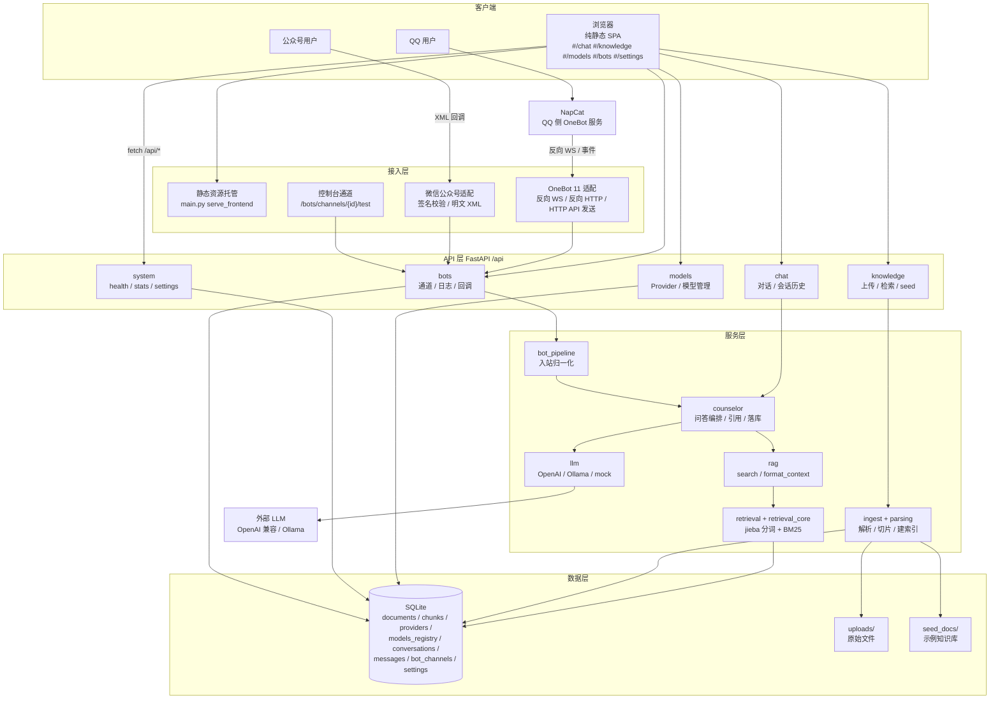
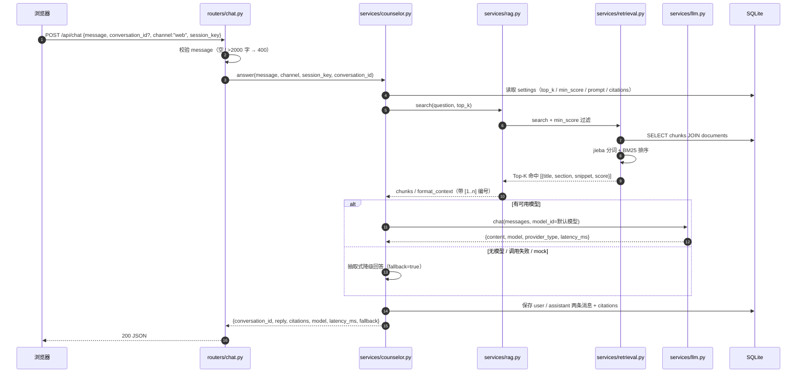
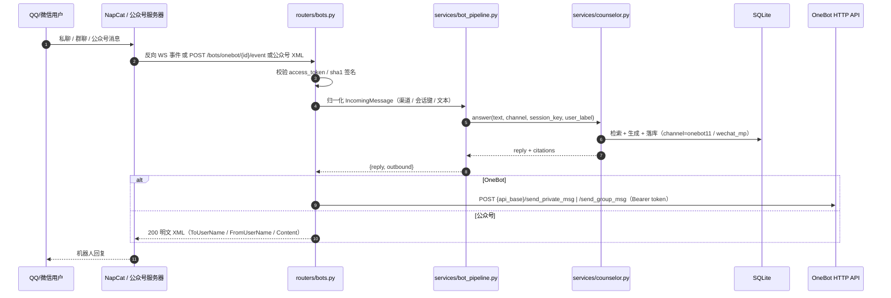
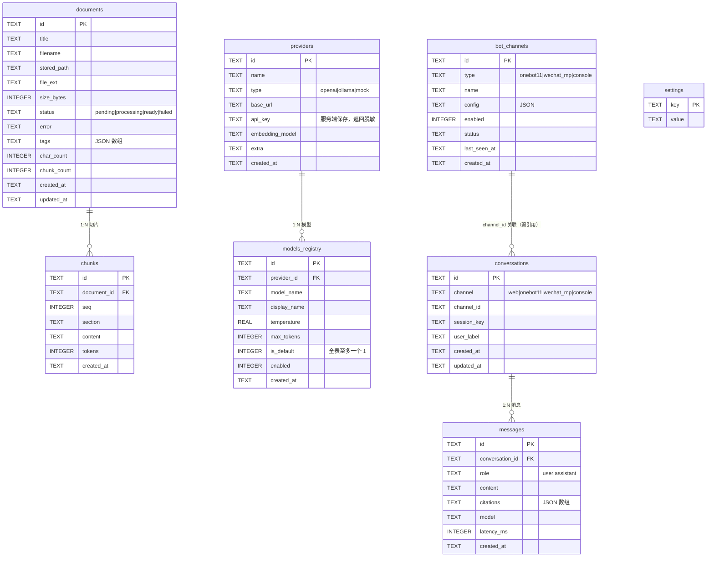

# NPU-Assistant 架构设计

本文说明 NPU-Assistant 的整体架构、请求链路、模块职责、数据模型与部署建议。接口字段以 [CONTRACT.md](CONTRACT.md) 为准，本文侧重视角是「系统如何组织起来」。

## 1. 设计目标

- **单进程、零外部依赖**：FastAPI + SQLite + 纯静态前端，`python -m uvicorn` 一条命令即可跑起来，无需 Node 构建、无需 Redis / 向量库。
- **零 API Key 可演示**：内置 mock Provider + 抽取式降级，保证无网络、无 Key 时 RAG 链路依然完整可用。
- **可替换的 LLM**：OpenAI 兼容 / Ollama / mock 三类 Provider 统一走 `services.llm.chat()`，上层无感知。
- **多渠道复用同一问答内核**：Web、QQ、微信、控制台四个入口统一调用 `services.counselor.answer()`，避免每个渠道重复实现 RAG。
- **默认安全、便于审计**：本地监听、API Key 脱敏、可选管理员令牌、SQLite WAL、数据全部落本地。

## 2. 总体架构



## 3. 关键请求链路

### 3.1 Web 对话一次问答



### 3.2 QQ / 微信机器人一次回复



### 3.3 知识库上传与检索

1. `POST /api/knowledge/documents`（multipart）→ 校验扩展名与大小（默认 20MB）→ 原始文件写入 `backend/data/uploads/<doc_id><ext>` → `documents.status=processing`；
2. `services.parsing` 按扩展名解析为纯文本（pdf→pypdf、docx→python-docx 含表格、xlsx→openpyxl、html→bs4 去标签、md/txt 原文、csv/json 转文本）；
3. `services.ingest` 按标题 / 段落切片（目标 300–600 字、重叠约 60 字），写入 `chunks`（`seq`、`section`、`tokens`），回填 `documents.chunk_count/char_count`，状态置 `ready`；解析失败置 `failed` 并写 `error`；
4. 检索时 `services.retrieval` 加载 `chunks JOIN documents`，交给 `retrieval_core.rank_chunks()` 做 BM25 排序，再按 `retrieval_min_score` 过滤，返回带文档标题与片段的 Top-K。

## 4. 模块职责

| 层 | 模块 | 职责 |
|----|------|------|
| 入口 | `backend/app/main.py` | 装配 FastAPI、挂载 `/api` 路由、静态前端托管、统一异常处理（`ValueError`→400） |
| 配置 | `backend/app/config.py` | 路径（`NPU_DATA_DIR` 可覆盖）、端口、上传限制、支持扩展名、默认设置与提示词 |
| 持久化 | `backend/app/db.py` | SQLite 建表与首启默认数据；`query/query_one/execute` 每次新连接；WAL；`now()/new_id()` 约定 |
| 安全 | `backend/app/security.py` | 可选 `NPU_ADMIN_TOKEN`：设置后写操作校验 `X-Admin-Token` |
| API | `routers/system.py` | `/health`、`/system/info`、`/system/stats`、`/settings` 读写 |
| API | `routers/chat.py` | `/chat` 问答、会话列表、历史消息、删除会话 |
| API | `routers/knowledge.py` | 文档上传 / 列表 / 详情 / 删除 / 重建索引 / 切片 / 检索 / seed / 统计 |
| API | `routers/models.py` | Provider 与模型 CRUD、默认模型切换、连通性测试、Key 脱敏 |
| API | `routers/bots.py` | 通道 CRUD、控制台模拟、日志、OneBot WS/HTTP、公众号 GET 校验与 POST 回复 |
| 服务 | `services/counselor.py` | 问答编排：设置 → 检索 → 提示词 → LLM/降级 → 引用编号 → 落库 |
| 服务 | `services/llm.py` | 三类 Provider 适配与超时、默认模型查询、Provider / 模型测试 |
| 服务 | `services/rag.py` | `search()` 对上层封装；`format_context()` 生成带编号【知识库资料】文本 |
| 服务 | `services/retrieval.py` / `retrieval_core.py` | 加载切片、BM25（jieba 分词、标题加权）排序、阈值过滤 |
| 服务 | `services/ingest.py` / `parsing.py` | 解析、切片、入库、重建索引、删除、幂等 seed |
| 服务 | `services/bot_pipeline.py` | 统一入站处理：会话键规则、调用 counselor、组织 outbound 报文 |
| 适配 | `adapters/onebot.py` | OneBot 11 事件归一化（私聊 / 群聊、文本段、忽略自身消息）、HTTP API 发送 |
| 适配 | `adapters/wechat_mp.py` | sha1 签名校验、明文 XML 解析与构造、非文本消息兜底 |
| 前端 | `frontend/index.html` + `assets/` | 单页应用、hash 路由、5 个视图、API 调用与 toast 错误展示 |

## 5. 数据模型



表说明补充：

- **settings**：键值对，存储 `counselor_name`、`system_prompt`、`welcome_message`、`quick_questions`、`retrieval_top_k`、`retrieval_min_score`、`citations_enabled`、`bot_reply_footer`；首启写入默认值。
- **documents / chunks**：知识库正排与切片；删除文档时级联删除切片并删除物理文件。
- **providers / models_registry**：`api_key` 只在服务端使用，API 返回 `前4****后4`；删除默认模型后自动把最早创建的启用模型设为默认。
- **conversations / messages**：所有渠道共用；`session_key` 是渠道内会话标识（Web 为 `web:{id|anonymous}`，QQ 私聊 `onebot11:{self_id}:private:{user_id}`，群聊加 `group:{group_id}`，微信 `wechat_mp:{channel_id}:{FromUserName}`）。
- **bot_channels**：`console` 通道不可删除，保证本地始终有可调试入口。

## 6. 检索与回答策略

- **分词**：`jieba` 精确模式 + 停用词表；中文长词额外按字符二元组（bigram）补充，保证「奖学金」能匹配「国家奖学金」；英文 / 数字按词索引。
- **打分**：BM25（`k1=1.5`、`b=0.75`），文档侧对标题做 2 倍加权、章节标题额外加权，让「标题命中」的切片排名更靠前。
- **阈值与条数**：`retrieval_top_k`（默认 4）与 `retrieval_min_score`（默认 0.05）均可在设置页调整；低于阈值的命中视为无结果。
- **提示词**：系统提示词约束「只依据知识库资料回答、不编造政策细节、句末标注 [n]、紧急情况优先给求助渠道」；资料以 `【知识库资料】` + `[1..n]` 编号注入，`max_chars=7000` 截断。
- **降级**：默认模型为 mock、无可用模型、网络超时或 Provider 报错时，`counselor` 用抽取式摘要生成回答并置 `fallback=true`，绝不 500；无命中时返回「知识库暂未收录 + 咨询渠道」。
- **引用**：citations 的 `index` 与回答里的 `[n]` 严格对应；`citations_enabled=false` 时不返回引用。

## 7. 部署建议

### 7.1 单机演示（推荐用于评审）

```powershell
.\scripts\run.ps1                      # 或 .\scripts\run.ps1 -Port 8010
# 反向代理（可选）：Nginx / Caddy 将 80/443 转发到 127.0.0.1:8000
```

- 保持单进程（uvicorn 单 worker）即可：SQLite 与进程内切片缓存按单实例设计；多 worker 会重复占用内存且无收益。
- 数据备份：定期复制 `backend/data/app.db`（WAL 模式下建议先停止服务或使用 `sqlite3 .backup`）与 `backend/data/uploads/`。

### 7.2 公网 / 生产化 checklist

| 项目 | 建议 |
|------|------|
| HTTPS | 使用 Caddy / Nginx + 证书，禁止明文暴露管理接口 |
| 管理员令牌 | 设置 `NPU_ADMIN_TOKEN`，前端写操作带 `X-Admin-Token`；或仅在内网开放 |
| 进程守护 | Windows 用 NSSM / 任务计划，Linux 用 systemd；配置崩溃自动重启 |
| 数据目录 | 通过 `NPU_DATA_DIR` 指向独立磁盘分区，纳入备份与磁盘告警 |
| 上传限制 | 保持 `NPU_MAX_UPLOAD_MB` 合理值（默认 20），反向代理同步设置 `client_max_body_size` |
| 日志 | 应用日志写文件并轮转；不要记录 API Key、完整学生隐私内容 |
| 合规 | 真实学生数据需脱敏；接入第三方 LLM 前完成数据出境与隐私评估 |
| 机器人 | 公众号使用加密模式（本 MVP 仅明文）；OneBot 配置 access_token 并限制来源 IP |

### 7.3 扩展方向（超出 MVP）

- 向量检索 / 混合检索：在 `retrieval.py` 内并联向量召回，保持 `rank_chunks` 接口不变；
- 流式输出：`POST /chat` 之外新增 SSE 接口，沿用 `counselor` 的检索与引用逻辑；
- 多租户与鉴权：在 `main.py` 前挂中间件，按院系隔离 settings 与知识库；
- 评测集：用 `backend/tests/` 扩展「问题 → 期望文档」命中率回归测试。

## 8. 测试与质量

- `backend/tests/conftest.py` 在导入应用前设置临时 `NPU_DATA_DIR` / `NPU_DB_PATH`，用 `TestClient` 驱动接口，测试结束清理，避免污染开发数据库；
- 覆盖范围：检索核心单测、知识库 seed / 上传 / 检索 / CRUD、对话降级与引用、模型管理（脱敏 / 默认模型回退）、机器人（签名 / 归一化 / 控制台模拟）；
- 全量命令：`.\scripts\check.ps1`；接口契约回归以 [CONTRACT.md](CONTRACT.md) 为准。
